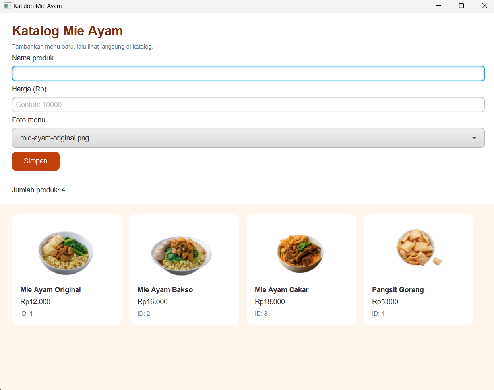

# Aplikasi Katalog 

Aplikasi desktop Java 17 mengikuti modul katalog produk: menu disimpan di SQLite, ditampilkan sebagai kartu bergambar, dan tetap ada ketika aplikasi dibuka kembali.

## Tampilan

## Fitur
- Tambah produk ke keranjang belanja 
- Tampilan katalog mie ayam dan harga

## Teknologi
- Java 17
- JavaFX 21
- Maven
- FXML + CSS untuk tampilan

## Cara Menjalankan
### Opsi 1: Dari source code (butuh JDK 17 + Maven)
1. Clone repository ini.
2. Buka project di NetBeans (atau IDE lain yang mendukung Maven).
3. Jalankan lewat goal Maven `javafx:run`: mvn clean javafx:run Atau di NetBeans: klik kanan `pom.xml` > Run Maven > Other Goals... > ketik `clean javafx:run`.

Kebutuhan: JDK 17 dan Maven. Database lokal dibuat otomatis di `data/katalog.db`.

## Catatan
Project ini dibuat untuk latihan pribadi dan sudah masuk kedalam database
